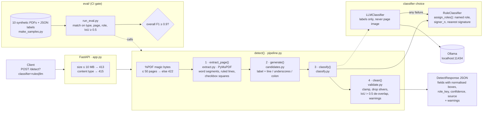

# fastapi-field-detector

Upload a PDF, get back proposed signature, initials, date, name and checkbox fields with
normalised positions, party roles and confidence scores. Built as a small FastAPI service so the
pipeline, the API and the evaluation are all easy to read.

```
PDF -> extract words, lines, squares -> candidates (rules) -> classify (rules or local LLM)
    -> validate (clamp, de-overlap, warn) -> JSON
```

## Architecture



## Run

```bash
pip install -e '.[dev]'
uvicorn field_detector.app:app --reload
curl -F 'file=@contract.pdf;type=application/pdf' localhost:8000/detect
curl -F 'file=@contract.pdf;type=application/pdf' 'localhost:8000/detect?classifier=llm'   # needs Ollama
pytest -q
python eval/make_samples.py && python -m eval.run_eval
```

## Pipeline

| Stage | File | Idea |
|---|---|---|
| Extract | `extract.py` | PyMuPDF words grouped into label-sized segments, ruled lines, checkbox squares |
| Candidates | `candidates.py` | A label (Signature, Date, Name, Initials) needs a ruled line, an underscore run, or a colon. Plain sentences containing a keyword are ignored |
| Classify | `classify.py` | Rules assign type and role. Optional local LLM confirms each candidate and refines the role. Any model failure falls back to rules |
| Validate | `validate.py` | Clamp to the page, drop slivers, suppress overlaps (IoU above 0.5), warn on low confidence or a role with no signature |

Why rules first: they are free, fast and explainable. The LLM only reviews candidates, so cost
stays proportional to the number of fields, not the number of pages.

## Evaluation (synthetic)

`eval/make_samples.py` draws 10 contracts with known field positions, including distractor
sentences and a no-field document. Matching needs the same type, page and role plus box IoU of 0.5.

| Type | F1 |
|---|---|
| signature | 1.00 |
| checkbox | 1.00 |
| initials | 1.00 |
| name | 1.00 |
| date | 0.92 |
| overall | 0.97 (precision 0.972, recall 0.972), 9 of 10 documents need zero edits |

**Be careful with these numbers.** The samples are synthetic and the generator shares conventions
with the detector, so this proves the mechanics, not real-world accuracy. Put real contracts and
hand-made labels in `eval/samples/` (same JSON format) and report those numbers instead.
CI fails if overall F1 drops below 0.9.

## API limits and safety

- PDFs only (magic-byte check), 10 MB, 50 pages. Errors return 413, 415 or 422.
- No document is stored. The LLM path sends label text only, never the page image.

## Deploy (free)

Deploys to **Vercel** (Python runtime, FastAPI preset) with no database and no secrets. Import the
repo in Vercel and deploy; `[tool.vercel]` in `pyproject.toml` points it at `field_detector.app:app`.
The full guide, including Vercel's 4.5 MB upload limit, is in [docs/deployment.md](docs/deployment.md).

The Render blueprint (`render.yaml`, built from the `Dockerfile`) is kept as a fallback.

## Known limits

- Text-based PDFs only. Scanned pages need OCR first (next step: Tesseract or a vision model).
- Roles come from role words and proximity to signatures. Unusual layouts need the LLM path.
- One signature box height per type, no handling of rotated pages.

## Changelog and contributing

Every change adds an entry under **Unreleased** in [`CHANGELOG.md`](CHANGELOG.md) and updates the
docs it affects (this README, `docs/`, and `NOTES.md` for mistakes). A CI job fails any pull request
that skips the changelog (label it `skip-changelog` for changes that truly need none). Before
opening a PR:

```bash
ruff check .
pytest -q
python eval/make_samples.py && python -m eval.run_eval
```

See `NOTES.md` for mistakes made and fixed.
